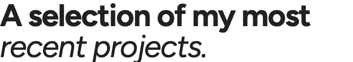
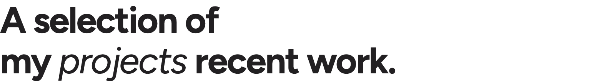
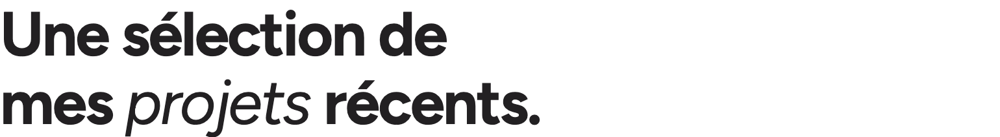

# Site fixes 1–6 — review evidence (2026-11-25)

Branch `fix/site-fixes-1-6` from `case-studies/foundation` (`f9e5b92`). Captured on this Mac (Chrome 158, arm64) against `npm run test:serve` on port 8000; the “before” state was served from a temporary checkout of `f9e5b92` on port 8014. Development evidence only, not the Linux release gate. Status table: [PROJECT-STATUS](../PROJECT-STATUS.md#site-fixes-16-branch-fixsite-fixes-1-6-2026-11-25).

## T1 — English Projects heading (mobile 393×852, tablet portrait 834×1112, DPR 2)

| | Before | After |
| --- | --- | --- |
| EN mobile |  |  |
| EN tablet |  |  |
| FR mobile (unchanged) |  |  |
| FR tablet (unchanged) |  |  |

Measurements after: mobile 32px, italic `<em>`, 2 lines at 360/393/430/499px, 3 lines at 320px (natural wrap), no overflow; tablet 48px, two title lines of 53px at 500×800, 834×1112 and 1194×834. Desktop iframe heading unchanged (`en/desktop-project-embedded.html` not regenerated differently).

## T2 — `--grid-margin-tablet`

Tablet 834×1112 and 1194×834 (iPad touch emulation), homepage and case page, FR/EN: token 24px → 32px; `--kc-page-gutter-x` and `--kc-page-gutter-bottom` 32px before and after. No stylesheet consumes the token, so nothing renders differently.

## T3 — language switch at the Footer of a case page

Scroll to the end of `/cases/_foundation/` (or the EN route) and click the switch.

| Profile | Before | After |
| --- | --- | --- |
| Desktop 1440×900 | paired route, y = 0 / 510 | `#contact`, y = 510 / 510 |
| Tablet 834×1112 | y = 0 / 501 | `#contact`, y = 501 / 501 |
| Mobile 393×852 | y = 0 / 483 | `#contact`, y = 483 / 483 |

Same results from FR and EN. Screenshots after arrival: `t3-before-case-<profile>-from-<lang>.png`, `t3-after-case-<profile>-from-<lang>.png`.

Homepage parity: 72 probes (FR/EN homepage and case, three profiles, scroll at 0/20/50/75/97/100 %) compared with `f9e5b92`. All homepage outcomes match except tablet FR About at 50 % and 75 %, which land on one of two positions (2767/3433, 4411/5077) from run to run on both versions (8 alternating repeats).

## T11 — availability pill at 500–607px

Every width 500–607px at height 800, FR/EN, mouse and touch contexts: homepage, case page and 404 all report profile `tablet` with the pill hidden; 0 mismatches.

## Matrix (492 points)

Homepage, case page and 404 (`/404.html`), FR/EN, widths 320–1920px in 20px steps at heights 500/800/1100 plus 1024×768, 1180×820 and 1366×1024 with iPad touch emulation. Per page: profile, logo and Hire position, pill visibility, page gutters, Footer heading size/left/top, legal left/bottom, case H1 size. [Before](matrix-before.csv) and [after](matrix-after.csv) are byte-identical; 0 rows differ between homepage and case page, 0 pill/profile differences against the 404.
